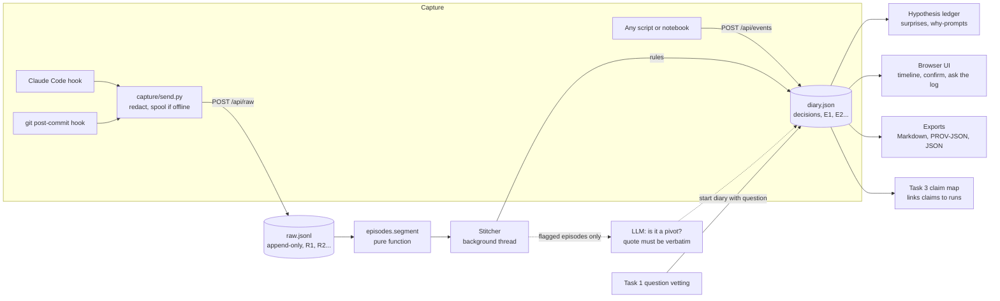

# Episteme

A flight recorder for AI-assisted research. Episteme captures what a researcher and an AI agent do during a study, turns it into a short diary of decisions, and records who stated each reason. A reviewer who wasn't there can then answer the hackathon brief's test question, *"why did they change approach at step 4?"*, from the log alone, with every answer citing the events behind it.

Built for the AI4MetaScience hackathon (brief: [`AI4MetaScience_Hackathon_Tasks.pdf`](AI4MetaScience_Hackathon_Tasks.pdf)). Task 2, the provenance notebook, is the core. Task 1 (vet a question) and Task 3 (check a paper's claims) are connected to it as one research lifecycle.

```bash
./run          # Python 3.9+, standard library only. Opens http://127.0.0.1:8765
```

No installs, no build step, no account. Everything stays on your machine in `.episteme/`. For a walkthrough of the app, see the [how-to-use guide](HOW_TO_USE.md).

## Contents

- [Design principles](#design-principles)
- [Architecture](#architecture)
- [Capture](#capture)
- [From raw activity to decisions](#from-raw-activity-to-decisions)
- [Who stated it: attribution](#who-stated-it-attribution)
- [Answering "why step 4?"](#answering-why-step-4)
- [Task 1 and Task 3](#task-1-and-task-3)
- [Data model and exports](#data-model-and-exports)
- [Models, search and offline use](#models-search-and-offline-use)
- [Security and privacy](#security-and-privacy)
- [Demos](#demos)
- [Testing](#testing)
- [Limits and future work](#limits-and-future-work)
- [API](#api)
- [Repository layout](#repository-layout)

## Design principles

1. **Capture while the work happens, not afterwards.** Hooks record the agent's instructions, tool calls, results and commits as they occur. Reconstructing reasons later is what the brief says goes wrong.
2. **Rules propose, the model confirms.** Deterministic rules build the diary instantly. A language model is asked only about the few episodes the rules flag as a possible change of approach, and never on the reviewer's read path.
3. **A model cannot put words in anyone's mouth.** A reason is labelled as stated only if it is a verbatim quote from the researcher's instruction or the agent's message. A paraphrase is kept separately and labelled as the model's.
4. **Every claim points at its evidence.** Diary events link to the raw events they came from. Answers cite diary events by ID.
5. **Works without a model.** Rules, search and the heuristic answerer run offline. A model adds depth but is never required.
6. **No dependencies.** Python 3.9+ standard library and vanilla JavaScript, so a reviewer can run it in one command and read all of it.

## Architecture



One local server (`episteme/server.py`, a stdlib `ThreadingHTTPServer` bound to 127.0.0.1) serves the UI and a JSON API. There is one diary at a time.

## Capture

| Source | How | What becomes a raw event |
|---|---|---|
| Claude Code | hook (`capture/claude_hook.py`) | each instruction, each tool call with its command and output tail, failures, the agent's final message per turn |
| git | `post-commit` hook | hash, message, changed file names, whether the agent or a person committed |
| Anything else | `POST /api/raw` or `POST /api/events` | raw activity, or ready-made diary events (labelled as coming from a script) |

`python3 capture/install.py /path/to/project` installs both hooks in a project (`--remove` undoes it). If Episteme is not running, events wait in `.episteme/spool.jsonl` and are sent in order later. The hook never blocks the agent or fails a tool call.

Scripts report outcomes as `RESULT` lines, which is how Episteme knows a run produced a result:

```
RESULT auroc=0.81 seed=42 split=cluster
```

Numbers become metrics; setup values such as `seed`, `n`, `epochs` or `lr` are kept as context and never compared. Names containing loss, error, rmse and similar are treated as lower-is-better.

Not captured: file contents, diffs, and the agent's intermediate messages within a turn. Details: [`capture/README.md`](capture/README.md).

## From raw activity to decisions

The raw log holds everything; the diary holds only decisions. Two steps connect them.

**1. Episodes** (`episteme/episodes.py`). `segment()` groups raw events into episodes:

- A non-trivial human instruction opens an episode. Acknowledgements ("ok", "continue", "fix that") join the open one.
- A run with `RESULT` lines, a real error, or a commit closes it. The agent's explanation right after a result stays with that result.
- A failed command re-run within two actions is a quick fix, not a boundary.

`segment()` is a pure function with bounded look-ahead, so episode IDs never change as new events arrive. Episodes are flagged for `failure`, `metric_drop`, `change_words` and `new_direction`.

**2. Stitching** (`episteme/stitcher.py`). For each finished episode, rules create diary events instantly:

| Event | Created when | Stated by |
|---|---|---|
| plan | a human instruction opened the episode; an expectation such as `AUROC >= 0.8` is extracted from it | researcher |
| run | a command printed a `RESULT`, or failed and closed the episode | agent |
| surprise | a run missed the plan's expectation (hypothesis ledger), or a metric dropped against the previous result | Episteme (inferred) |
| artifact | a commit | agent or researcher, from the git hook |
| pivot | the episode was flagged as a possible change of approach | see below |

A flagged episode first gets a *pending* pivot built by the rules, shown at once. In the background, the model decides whether it is a real change of approach, from what to what, and why, and must quote the reason word for word. The model call runs outside the stitcher's lock, so a slow model never blocks the UI. With no model, the pivot stays pending and the researcher can write the reason in one line.

## Who stated it: attribution

Each diary event carries an `actor` and a provenance label, shown as a badge on the timeline:

| Badge | Meaning | Trust |
|---|---|---|
| researcher | the person's own words (an instruction, a note, a reason they typed or edited) | stated |
| agent | the agent's own words, quoted verbatim from its message | stated |
| agent ✓ | an agent-stated reason the researcher confirmed with one click | stated, confirmed |
| inferred | reconstructed by Episteme's rules or a model paraphrase | lower |
| pending | flagged by rules, not yet classified or confirmed | lowest |

Attribution is decided by the server, never by the caller: `server.py` strips attribution fields (`actor`, `confirmed_by`, `quote`, `raw_ids` and others) from posted events. Confirming, editing or skipping a reason only works from the Episteme page itself (see [Security and privacy](#security-and-privacy)). The reason the researcher confirms is never overwritten by a later model pass.

## Answering "why step 4?"

`POST /api/ask` answers a reviewer's question from the diary only.

- **With a model:** the diary is sent with each event's "who stated it" field. The model must cite every statement by event ID (`[E4]`), say whose statement it rests on, flag inferred reasons as less reliable, and say plainly when the log has no answer.
- **Without a model:** a heuristic answerer resolves "step N" or "E7" directly, finds the pivot linked to it and explains it with its trigger and evidence, or falls back to keyword (TF-IDF) ranking over events.

Citations render as chips that jump to the event on the timeline, so the reviewer can check each claim.

## Task 1 and Task 3

**Task 1, vet a question** (`pipeline.py`, `question.py`, `search.py`). A three-stage background job:

1. **Local rules:** a lexicon of contested constructs and assumption patterns. Instant; nothing leaves the machine.
2. **Literature search:** keywords only, never the full question, go to free scholarly APIs. This finds existing reviews, how papers measure each term, and candidate datasets.
3. **AI refinement:** the model proposes sharper searches, Episteme runs them, and the model writes a critique that may cite only retrieved papers. Invented IDs are dropped.

Output: ambiguous terms with their senses, implicit assumptions, evidence needed and whether it is obtainable, and a proceed / narrow / revise / stop verdict. Each finding is tagged `rule`, `search` or `AI`. A refined question can start the diary.

**Task 3, claim map** (`claims.py`). For a paper's text:

- Each claim gets its certainty wording (strong, moderate, hedged), its anchors (figures, tables, sections, code files) and whether those anchors exist in the paper.
- Weak-evidence cues (single seed, small n, no error bars) and scope words ("generalises", "across hospitals") are compared with the claim's wording.
- The status is one of supported / weak evidence / overclaimed / no evidence, with the reasons.
- Numbers in a claim are traced back to the diary runs that produced them.
- An explicit checked vs not-verified ledger comes with every map.

## Data model and exports

State lives in `.episteme/` (gitignored). Each study has its own folder, `studies/<id>/`, holding `diary.json`, `raw.jsonl` and `stitch.json`; `current` names the open one. Shared files: `config.json`, `token`, `spool.jsonl`. Capture hooks always write to the open study.

A diary event (full shape in the docstring of `episteme/store.py`):

```json
{
  "id": "E4", "ts": "2026-11-13T14:05:00+01:00", "type": "pivot",
  "title": "Switch from a random split to a family split",
  "detail": "the random split leaks near-identical sequences",
  "actor": "human", "provenance": "stated", "quote": "the random split leaks near-identical sequences",
  "model_summary": "Changed the split to avoid leakage between similar proteins",
  "classified_by": {"model": "GLM-5.3-Flash", "at": "2026-11-13T14:05:09+01:00"},
  "links": ["E2", "E3"], "raw_ids": ["R7", "R8"], "episode_id": "EP-R7"
}
```

Types: `plan` (with `expectation`), `run` (with `result`, `status`, `code`, `params`, `data`), `surprise`, `pivot`, `note`, `artifact`, `question`.

Exports (`GET /api/export?format=`):

- `md`: a decision appendix for a paper or report.
- `prov`: W3C PROV-JSON. Researcher, agent, Episteme and each classifying model are PROV agents; confirmation and classification are attribution relations.
- `json`: the raw diary.

## Models, search and offline use

The model layer (`llm.py`) exposes two functions, `text()` and `structured()`. Providers: Anthropic, OpenAI and any OpenAI-compatible server (LM Studio, vLLM, OpenRouter, Berget AI), Gemini, and local Ollama. Configuration order: settings saved in the UI, then `EPISTEME_*` environment variables (`./run` reads `.env`), then provider key variables, then a running Ollama, then no model. The stitcher can use a smaller, faster model than the one answering questions.

Search (`search.py`) queries free sources in parallel and merges the results:

- **Papers:** Semantic Scholar, OpenAlex, Europe PMC, PubMed, Crossref, arXiv.
- **Datasets:** Zenodo, DataCite, Hugging Face.
- **Web (your own key):** Brave, Serper and Tavily, tried in order.

Failing sources are paused with a growing cooldown, and a background poller re-checks them every 10 minutes. Results are cached for an hour.

`./run --offline` turns off all network use. The diary, ledger, rules and heuristic answers still work.

## Security and privacy

- The server binds to 127.0.0.1 and checks the `Host` and `Origin` headers, which blocks other web pages and DNS rebinding.
- State-changing routes (confirm, pivot, delete, demo, clear, settings, sources) need a random token that changes on every start and is embedded only in Episteme's own page.
- Secrets are stripped from captured text before it is stored or sent (`redact.py`): common key formats, bearer tokens, passwords in URLs, secret-looking `key=value` pairs, and values of environment variables named like KEY, TOKEN, SECRET or PASSWORD. This is pattern-based: a safety net, not a guarantee.
- API keys entered in the UI are saved only to `.episteme/config.json` with file mode 600.
- What leaves the machine: search keywords to the search APIs, and, if a model is configured, the relevant text to that provider. Nothing else.

The token stops other web pages and naive scripts. Anything that can read your files can also read `.episteme/token`.

## Demos

The start screen offers two demos. Both are **simulated studies**, not records of real published work:

- **Hospital readmission:** a TF-IDF baseline misses its expected AUROC, and the researcher switches to PubMedBERT embeddings at step 4. It comes with a paper that overstates the results, for Task 3.
- **AlphaFold:** a reconstructed mid-2020 session in which the AlphaFold 1 pipeline stalls and the team moves to an end-to-end architecture. The background is in [`docs/ALPHAFOLD_HISTORICAL_DISCOVERY_DEMO.md`](docs/ALPHAFOLD_HISTORICAL_DISCOVERY_DEMO.md).

Each demo is a raw capture session (`demo/*.jsonl`, listed in `demo/demos.json`) and loads through the same path as live capture: raw log, episodes, stitcher. Demos therefore exercise the real pipeline and cannot drift from it. `tools/replay.py demo/<id>.jsonl` replays a session into a running Episteme at real-time pace, for watching the diary fill in. To add a demo, add a `.jsonl` file and an entry in `demos.json`.

## Testing

```bash
python3 -m unittest discover -s tests     # 96 tests, about 7 s, Python 3.9 and 3.13
```

| File | Tests | Covers |
|---|---|---|
| `test_episodes.py` | 27 | segmentation rules, RESULT parsing, flags, store and ledger behaviour |
| `test_stitcher.py` | 19 | rules to events, verbatim-quote check, pending pivots, model calls outside the lock |
| `test_capture.py` | 15 | Claude Code and git hooks, redaction, offline spool |
| `test_confirm.py` | 13 | confirm, edit and skip; reasons never overwritten; attribution in exports |
| `test_demos.py` | 9 | demo loading through the pipeline; replay and load give the same diary |
| `test_security.py` | 8 | token, Host and Origin checks; attribution fields stripped from posted events |
| `test_replay.py` | 5 | session replay tool |

Task 1 search and question vetting, and the Task 3 claim map, have no automated tests yet. They were checked by hand in the browser.

## Limits and future work

- **One agent session per project at a time.** Two parallel Claude Code sessions in one project interleave, and a result can be linked to the wrong instruction.
- **Agent capture covers Claude Code only.** Other tools can post to `/api/raw`. Decisions made outside the agent, such as in a meeting, need the why-prompt or a manual note.
- **Long background jobs** (cluster jobs, `nohup`) report results outside the hook and need a manual log entry.
- **Reasons are only as honest as the record.** Verbatim quotes prove who said something, not that it was the true cause. The expected-versus-observed check in the ledger is the part that does not rely on anyone's account.
- **The claim map reads plain text only:** no PDF parsing or figure reading. Its claim detection is pattern-based, with optional model help.
- **Answers from a model cite event IDs, but those citations are not machine-checked yet.** Task 1 already drops invented paper IDs, and the same check should apply here.
- **Tamper evidence (future):** chain each diary event to the hash of the previous one, and anchor the latest hash externally (for example with OpenTimestamps), so a reviewer can tell whether the log was edited after the fact.

## API

All JSON, on `http://127.0.0.1:8765`. Routes marked † need the page token.

| Route | Purpose |
|---|---|
| `GET /api/events`, `POST /api/events` | read the diary; add an event (attribution fields are stripped) |
| `POST /api/raw`, `GET /api/raw`, `GET /api/episodes`, `GET /api/stitch` | raw capture in; raw log, episodes and stitcher status out |
| `GET /api/prompts`, `POST /api/confirm` †, `POST /api/pivot` † | pivots waiting for the researcher; confirm, edit or skip them |
| `POST /api/ask` | answer a question from the diary |
| `GET /api/export?format=md\|prov\|json` | exports |
| `POST /api/question/start`, `GET /api/jobs/<id>` | Task 1 staged job |
| `POST /api/claims`, `GET /api/demo-paper` | Task 3 claim map; the loaded demo's paper |
| `GET /api/studies`, `POST /api/studies/new` †, `POST /api/studies/open` †, `POST /api/studies/delete` † | saved studies: list, new, open, delete (never the open one) |
| `GET /api/demos`, `POST /api/demo` †, `POST /api/clear` †, `POST /api/delete` † | demos (opens the saved copy, or loads it into a new study), empty the open study, delete an entry |
| `GET /api/status`, `POST /api/settings` †, `GET /api/sources`, `POST /api/sources` †, `POST /api/sources/check` | model and search configuration and health |

## Repository layout

```
run                     launcher: loads .env, starts the server, opens the browser
episteme/server.py      HTTP server and JSON API (127.0.0.1 only)
episteme/store.py       diary (diary.json) and raw log (raw.jsonl)
episteme/studies.py     saved studies, one folder each
episteme/episodes.py    raw events -> episodes (pure function)
episteme/stitcher.py    episodes -> diary events; rules propose, the model confirms
episteme/diary.py       hypothesis ledger, why-prompts, confirm flow, ask the log
episteme/redact.py      secret stripping
episteme/llm.py         provider-agnostic model layer
episteme/pipeline.py    Task 1 staged job; question.py has its rules, search.py the sources
episteme/claims.py      Task 3 claim map
episteme/demos.py       demo loading (demo/demos.json)
episteme/export.py      Markdown, PROV-JSON and JSON exports
episteme/static/        UI: vanilla HTML, CSS and JavaScript (themes.css is generated)
capture/                Claude Code and git hooks, sender, installer
tools/replay.py         replay a recorded session into a running Episteme
tools/build_themes.py   theme palettes with a WCAG AA contrast check
demo/                   demo sessions, index and paper
tests/                  unit tests (unittest, no dependencies)
```

Planning documents from the hackathon (`claude_research.md`, `gemini_research.md`, `design.md`, `bugs.md`) are kept for reference and are not part of the tool.
