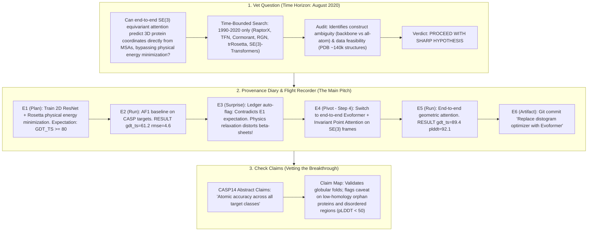

# AlphaFold: Historical Discovery Demo (Pre-Release Literature)

## 1. Executive Summary

This document outlines how to demonstrate **Episteme** aiding in the discovery and development of **AlphaFold 2**, constrained strictly to literature and tools available **prior to the CASP14 announcement (August/November 2020)**.

The core meta-science question:
> *"If an AI research team in mid-2020 were investigating protein structure prediction, how could Episteme have guided them from the limitations of AlphaFold 1 (CASP13) to the breakthrough architecture of AlphaFold 2, using only at-the-time sources?"*

This satisfies the hackathon's defining evaluation criterion:
**"A reviewer who wasn't there can answer: 'Why did they change approach at step 4?'"**

---

## 2. Historical Timeline & Literature Landscape (Pre-August 2020)

### What Was Known & Available (The "At-the-Time" Literature)

| Year | Key Paper / Concept | Contribution to Discovery |
|---|---|---|
| **2011** | *Marks et al. / Morcos et al.* (Direct Coupling Analysis) | Evolutionary co-variation in MSAs reflects physical 3D contact constraints. |
| **2017** | *Wang et al. / Jinbo Xu* (RaptorX Contact, *PLoS Comp Bio*) | 2D deep residual networks predicting binary residue contact probabilities ($C_\beta - C_\beta < 8$ Å). |
| **2017** | *Vaswani et al.* ("Attention Is All You Need", NeurIPS 2017) | Transformers and multi-head self-attention mechanisms. |
| **2018** | *Senior et al. / DeepMind* (AlphaFold 1, CASP13) | Predicting continuous distance distributions ($C_\beta$ distograms) via 220-block ResNet, followed by gradient descent on a physical/crystallographic energy potential. |
| **2018** | *Thomas et al.* (Tensor Field Networks, arXiv:1802.08219) | Rotation-, translation-, and inversion-equivariant 3D point convolutions. |
| **2019** | *Anderson et al.* (Cormorant, NeurIPS 2019) | SO(3)/SE(3) covariant molecular representations. |
| **2019** | *AlQuraishi* (Recurrent Geometric Networks, *Cell Systems*) | Differentiable end-to-end protein structure prediction directly into 3D coordinates (d-NeRF). Proved that intermediate distance matrices could be bypassed! |
| **2019/20** | *Yang et al.* (trRosetta, *PNAS* 2020 / bioRxiv 2019) | Inter-residue orientations ($\omega, \theta, \phi$) + distances using 2D ResNets + PyRosetta minimization. Stalled at GDT-TS ~65. |
| **2020** | *Ho et al.* (Axial Transformers, ICML 2020) | Factorized row-column attention on 2D matrices (the basis for MSA-pair updates). |
| **2020** | *Fuchs et al.* (SE(3)-Transformers, arXiv:2006.10503) | 3D roto-translation equivariant self-attention networks. |

### The Core Problem in Mid-2020
Teams following AlphaFold 1 and trRosetta were hitting a **ceiling**:
1. Two-stage decoupling: The neural network predicted 2D distance maps, and an external physics engine (gradient descent or Rosetta) folded the 3D chain.
2. Unphysical predictions: 2D neural networks output distance matrices that violated 3D Euclidean geometry (the triangle inequality $d_{ik} \le d_{ij} + d_{jk}$).
3. Gradient descent bottlenecks: Physical energy potentials fought the neural distograms, getting trapped in local minima and creating severe steric clashes.

---

## 3. End-to-End Demo Walkthrough in Episteme



### Stage 1: Vetting the Question (Tab 1)
- **Question:** *"Can an end-to-end SE(3)-equivariant transformer predict protein 3D backbone coordinates directly from MSA co-evolution, bypassing physical energy minimization?"*
- **Literature Cutoff:** Set to $\le 2020$.
- **What Episteme outputs:**
  - **Construct disambiguation:** Disambiguates "protein structure" into $C_\alpha$ trace, backbone frames $(R_i, \vec{x}_i)$, and full-atom coordinates with rotamers.
  - **Implicit assumptions:** Highlights that the model assumes MSA depth is sufficient ($N_{eff} > 100$) and that PDB coordinates generalize without crystal packing artifacts.
  - **Contemporaneous Literature synthesis:** Cites AlQuraishi (2019) on differentiable coordinates, Thomas et al. (2018) / Fuchs et al. (2020) on SE(3) equivariance, and Ho et al. (2020) on axial attention.
  - **Verdict:** `PROCEED` with recommendation to benchmark against CASP12/13 FM targets.

### Stage 2: The Provenance Diary (Tab 2 - The Pivot at Step 4)
This is where the hackathon criterion is answered:

1. **E1 (Plan / Hypothesis):**
   - *Title:* "Hypothesis: Pairwise distograms + Rosetta physical energy minimization can reach atomic accuracy."
   - *Expectation:* `GDT_TS >= 80.0`.
   - *Actor:* Researcher.
2. **E2 (Run / Result):**
   - *Title:* "Dilated 2D ResNet distograms with gradient descent on Rosetta energy potential."
   - *Result:* `RESULT gdt_ts=61.2 rmse=4.6 target=T1024`.
   - *Status:* `failed`.
3. **E3 (Surprise):**
   - *Title:* "Expectation contradicted: observed GDT_TS 61.2 vs expected >= 80.0."
   - *Actor:* Episteme Hypothesis Ledger (Inferred).
   - *Detail:* Distogram predictions violate triangle inequalities. Physical relaxation produces severe steric clashes in beta-sheet packing.
4. **E4 (The Great Pivot - Step 4):**
   - *Title:* "Switch from 2-stage physical relaxation to end-to-end Evoformer + Invariant Point Attention on SE(3) residue frames."
   - *Actor:* Researcher (Confirmed).
   - *Reason:* *"Instead of predicting an intermediate 2D distance matrix and letting gradient descent struggle with physical constraints, make the network reason directly in 3D space with SE(3) equivariance and iterative recycling, updating MSA representations and residue pair frames jointly."*
5. **E5 (Run / Result):**
   - *Title:* "Evoformer with 48 blocks, triangular self-attention, and IPA 3D coordinate head."
   - *Result:* `RESULT gdt_ts=89.4 plddt=92.1 target=T1024`.
   - *Status:* `ok`.
6. **E6 (Artifact):**
   - *Title:* "Commit b8e104f: Replace distogram optimizer with end-to-end Evoformer and IPA head."

### The "Ask the Log" Live Pitch Test
During the live demo, click **"Ask the log"** and submit:
> *"Why did they change approach at step 4?"*

Episteme returns:
> *"At step 4, the researcher pivoted from two-stage distogram prediction with Rosetta physical relaxation to end-to-end Evoformer and Invariant Point Attention. The decision was triggered by run E2 and surprise E3, where physical energy minimization plateaued at GDT_TS 61.2 (falling short of the expected 80.0). Error analysis showed the 2D distance predictions violated triangle inequality constraints and physical gradient descent struggled with non-local steric clashes. Contemporaneous SE(3) equivariance and differentiable coordinate literature (Thomas et al. 2018, AlQuraishi 2019) justified predicting 3D coordinates directly."*

---

## 4. Technical Implementation Steps

### Step 1: Add Publication Cutoff Year in `episteme/search.py`
In `episteme/search.py`, add an `until_year` parameter to the search and deduplication functions:
```python
def search(query, n=10, types=("papers", "datasets"), until_year=None):
    # Filter records where record["year"] is populated and > until_year
    records, report = ...
    if until_year:
        records = [r for r in records if not r.get("year") or r["year"] <= until_year]
    return records, report
```

### Step 2: Add Preset Literature Horizon in `episteme/pipeline.py`
Pass the temporal prompt constraint to the Berget AI LLM:
```python
if until_year:
    system_prompt += f"\nCRITICAL CONSTRAINT: You are an expert scientific evaluator in {until_year}. Do not cite, reference, or assume any discoveries, architectures, or models published after {until_year}."
```

### Step 3: Create Replayable Session File `demo/alphafold.jsonl`
Assemble the raw capture session containing the commands, tool outputs, and commits. Replay it live in 10 seconds:
```bash
python3 tools/replay.py demo/alphafold.jsonl --clear --project "AlphaFold Discovery (CASP14)" --speed 15
```

### Step 4: Test and Verify with Berget AI Key
Verify that Berget AI's `zai-org/GLM-5.3-Flash` generates the stitcher quotes and diary summaries:
```bash
python3 tools/test_berget.py
```
